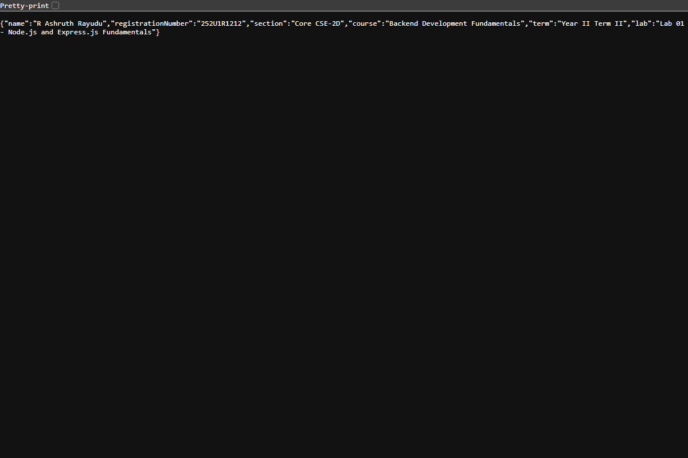

# Lab 1: Node.js and Express server

**Student Name**:  R Ashruth Rayudu
**Registration Number**: 252U1R1212  
**Section**: Core CSE-2D  
**Course**: Backend Development Fundamentals (Year II Term II)  
**Faculty**: Shiva Sai Teja  
**Repository**: [Ashruth-R/BDF-LAB-REPORTS-252U1R1212](https://github.com/Ashruth-R/BDF-LAB-REPORTS-252U1R1212)  
**Live Link**: [https://bdf-lab-01-express.onrender.com](https://bdf-lab-01-express.onrender.com)

---

## 1. Project Overview & Objectives

The primary objective of this laboratory is to establish a solid foundation in backend JavaScript engineering using Node.js and the Express.js framework:
1. Understand the core Node.js runtime environment and package management ecosystem.
2. Initialize and configure a project repository with `npm init -y` and analyze the anatomy of `package.json`.
3. Install and inspect external third-party dependencies (`express`) within `node_modules`.
4. Construct a low-level HTTP server using Node.js's standard `http` library (`http.createServer`).
5. Refactor and scale the application into an Express.js server utilizing `express()` and `app.listen(3000)`.
6. Implement distinct RESTful routing endpoints (`/`, `/about`, `/time`) and handle unexpected routes via a custom 404 middleware.
7. Conduct systematic route verification and status code auditing.

---

## 2. Explanation of `package.json` Fields

When running `npm init -y`, npm generates a baseline manifest file named `package.json`. Below is an explanation of each primary field:

| Field | Purpose & Description |
| :--- | :--- |
| `"name"` | The unique identifier / package name of the project. It must be lowercase, URL-safe, and contain no spaces. |
| `"version"` | The current release version of the application, typically adhering to Semantic Versioning (`MAJOR.MINOR.PATCH`). |
| `"description"` | A concise, human-readable summary detailing the purpose and scope of the package/project. |
| `"main"` | The primary entry point file of the application (e.g., `server.js`). When imported as a module, execution begins here. |
| `"scripts"` | A dictionary of custom CLI alias commands executed via `npm run <script-name>` (e.g., `start`, `test:routes`). |
| `"keywords"` | An array of indexing keywords that assist searchability in the npm registry. |
| `"author"` | The person or organization responsible for authoring and maintaining the project. |
| `"license"` | Specifies the legal licensing terms governing the reuse and distribution of the code (e.g., `ISC`, `MIT`). |
| `"dependencies"` | Lists runtime packages and their permissible semver ranges required for production execution (e.g., `"express": "^4.21.2"`). |

---

## 3. How to Run

### Prerequisites
- Node.js (version 18.x, 20.x, or 24.x recommended)
- npm (Node Package Manager)

### Installation
Clone or navigate to the repository folder and enter the `lab-01` directory:
```bash
git clone https://github.com/Ashruth-R/BDF-LAB-REPORTS-252U1R1212.git
cd BDF-LAB-REPORTS-252U1R1212/lab-01
npm install
```

### Environment Variables (Optional)
The application works out-of-the-box with sensible defaults, but accepts custom overrides via environment variables:
```bash
PORT=3000
STUDENT_NAME="R Ashruth Rayudu"
STUDENT_REG_NO=252U1R1212
STUDENT_SECTION="Core CSE-2D"
```

### Start Commands
- **Run the Express Server (Tasks 4–6)**:
  ```bash
  npm start
  ```
  *(Launches the Express server on `http://localhost:3000`)*

- **Run the Plain Built-in HTTP Server (Task 3)**:
  ```bash
  npm run start:http
  ```
  *(Launches the low-level Node.js `http` server on `http://localhost:3000`)*

- **Execute Automated Route & Status Code Verification (Task 7)**:
  ```bash
  npm run test:routes
  ```

- **Re-generate Browser Screenshots**:
  ```bash
  npm run capture:screenshots
  ```

---

## 4. Endpoints & API Specification

| HTTP Method | Path | Description | Expected Status Code | Sample Response Body |
| :--- | :--- | :--- | :--- | :--- |
| `GET` | `/` | Welcome text greeting users to the server | `200 OK` | `Welcome to Lab 1: Node.js and Express Server!` |
| `GET` | `/about` | JSON object containing student & course details | `200 OK` | `{"name":"R Ashruth Rayudu","registrationNumber":"252U1R1212","section":"Core CSE-2D",...}` |
| `GET` | `/time` | Current system timestamp computed via `new Date()` | `200 OK` | `Current Date and Time: Sat Oct 31 2026 13:45:00 GMT+0530 ...` |
| `ALL` | `*` (any unknown path) | Catch-all 404 middleware returning an error message | `404 Not Found` | `404 Not Found: Cannot GET /non-existent-endpoint` |

---

## 5. Screenshots

The output of each endpoint was verified in the browser / client and captured below:

### 5.1 Route: `GET /` (Welcome Text)


### 5.2 Route: `GET /about` (Student Info JSON)


### 5.3 Route: `GET /time` (Current Date & Time)


### 5.4 Unknown Route: `GET /unknown` (404 Not Found)


### 5.5 Plain HTTP Server: `http-server.js` (Task 3)


---

## 6. Viva Questions & In-Depth Answers

### Q1: What is the difference between `package.json` and `node_modules`?
- **`package.json`**:
  - A lightweight manifest configuration file tracked in Git.
  - Contains project metadata, developer scripts, and direct dependency names with semver version requirements.
  - Human-readable and editable.
- **`node_modules`**:
  - The local directory where the actual source code and binaries of installed packages and their transitive dependencies reside.
  - Can be hundreds of megabytes in size, containing thousands of files.
  - **Never committed to version control**; it can be recreated cleanly at any time by running `npm install` from `package.json`.

### Q2: What does `app.listen()` do?
- In Express, `app.listen()` binds the application to a designated TCP network port (e.g., port 3000) and begins listening for incoming HTTP connections.
- Internally, `app.listen()` is a convenience method that instantiates Node's native `http.Server` instance (`http.createServer(this)`) and invokes `.listen()` on it with the specified port, host, and optional callback.

### Q3: What do `request` and `response` represent?
- **`request` (`req`)**:
  - An object representing the incoming HTTP request dispatched by the client (browser, curl, Postman).
  - Encapsulates details such as the HTTP method (`GET`, `POST`), target URL path, headers, query parameters (`req.query`), route parameters (`req.params`), and payload body (`req.body`).
- **`response` (`res`)**:
  - An object used by the server to construct and dispatch the outgoing HTTP response back to the requesting client.
  - Provides methods such as `res.status()` to set HTTP response status codes, `res.set()` to assign headers, `res.send()` to emit text/HTML, and `res.json()` to serialize and emit JSON formatted data.

---

## 7. Notes: Problems Faced & Solutions

1. **Path Quoting with Parentheses in Project Directory**:
   - *Problem*: The workspace directory path contained parentheses (`BDF(Backend Development Fundamentals)_PROJECTS`). When executing PowerShell sub-commands or child processes, unquoted parentheses caused PowerShell parser syntax errors or path resolution issues.
   - *Solution*: Explicitly wrapped paths with quotes and executed npm commands within the target directory context using `Cwd`.
2. **Preventing `node_modules` from Git Tracking**:
   - *Problem*: Installing packages generates a heavy `node_modules/` folder that should never be pushed to GitHub.
   - *Solution*: Configured `.gitignore` at both the lab root and `lab-01/` before running any package installations, verifying `git status` ignores it.
3. **Catch-All 404 Route Placement**:
   - *Problem*: Placing a catch-all 404 handler above defined routes would intercept all requests and prematurely terminate them with 404.
   - *Solution*: Placed the 404 middleware (`app.use((req, res) => { ... })`) at the very end of the middleware and route declaration stack so it only triggers if no preceding route handler matches.
