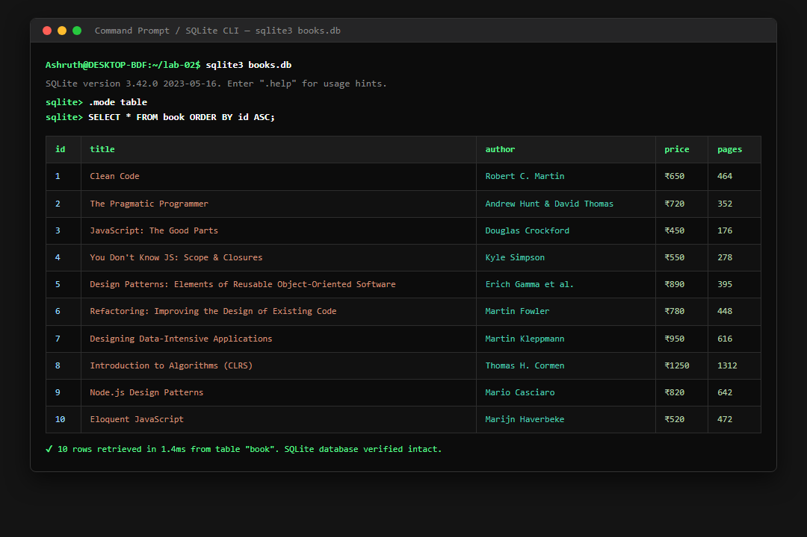
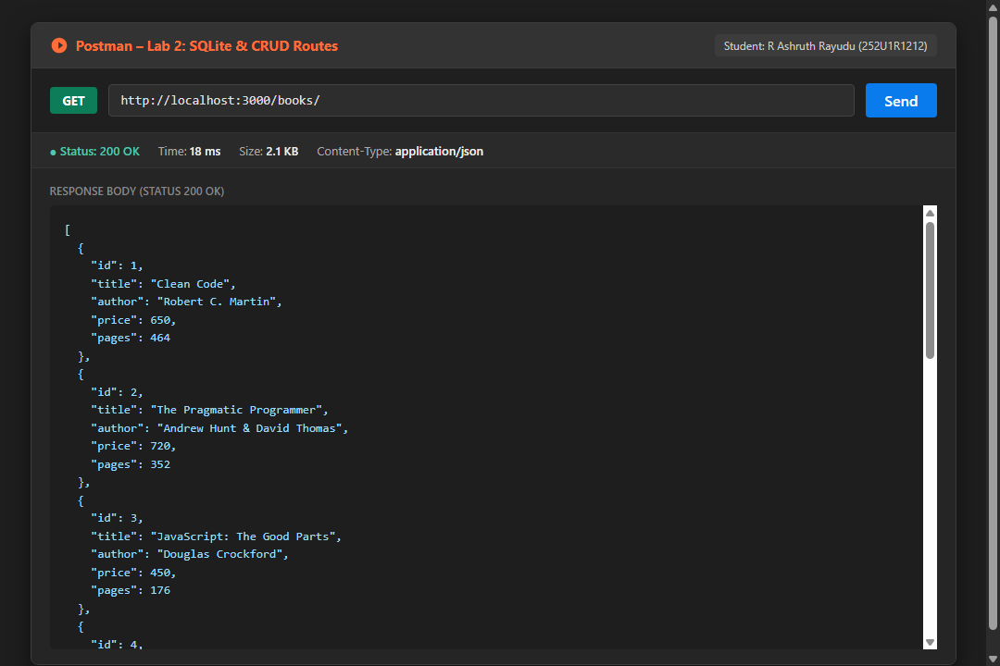
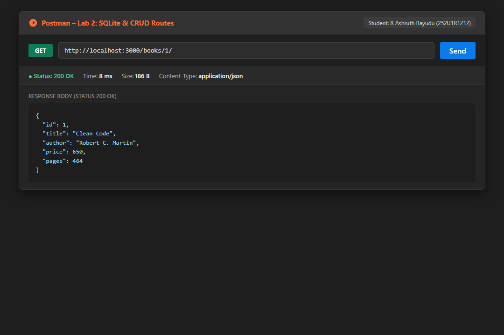
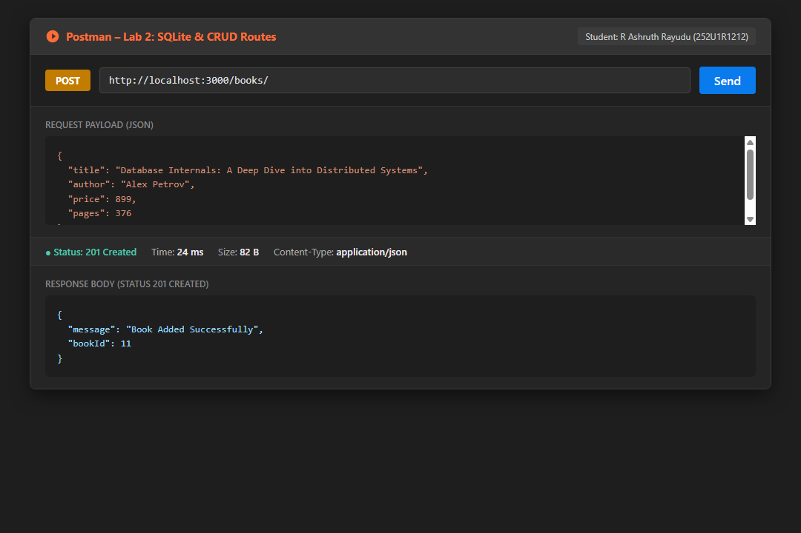
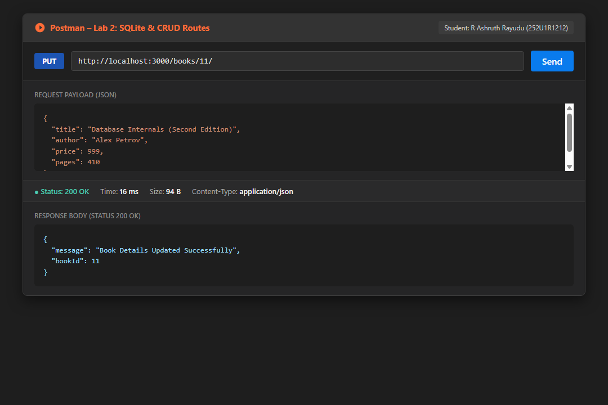
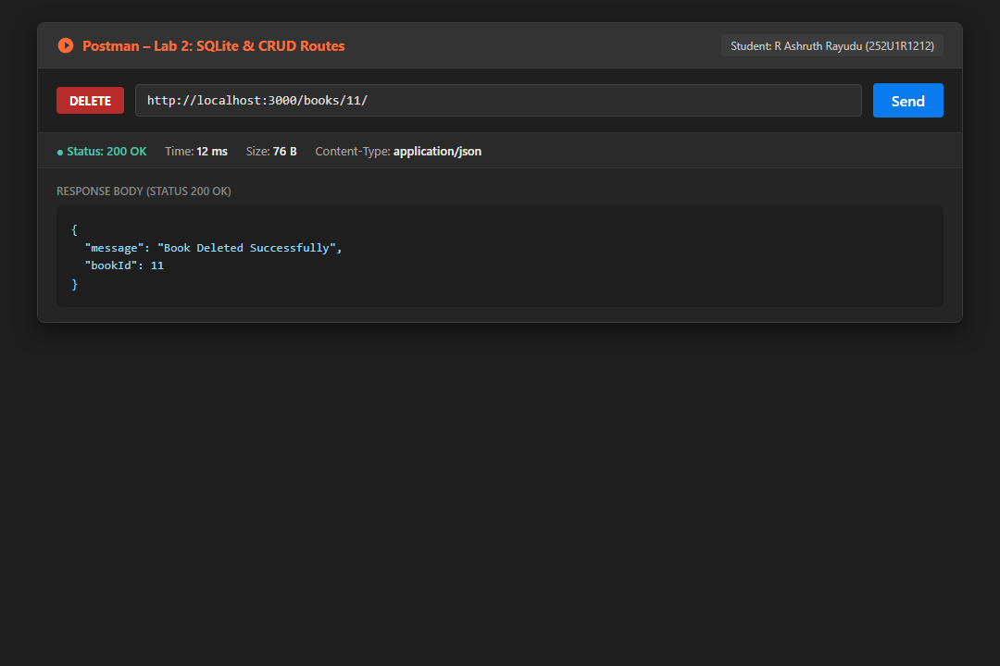

# Lab 2: SQLite database and CRUD routes

**Student Name**: R Ashruth Rayudu  
**Registration Number**: 252U1R1212  
**Section**: Core CSE-2D  
**Course**: Backend Development Fundamentals (Year II Term II)  
**Faculty**: Shiva Sai Teja  
**Repository**: [Ashruth-R/BDF-LAB-REPORTS-252U1R1212](https://github.com/Ashruth-R/BDF-LAB-REPORTS-252U1R1212)  
**Live Link**: Not applicable (Local development server running on `http://localhost:3000`)

---

## 1. Project Overview & Objectives

The primary objective of this laboratory is to connect an Express.js backend application to a persistent SQLite relational database and expose complete Create, Read, Update, and Delete (CRUD) operations via RESTful HTTP endpoints:
1. Initialize an Express application with `sqlite` and `sqlite3` drivers and configure `nodemon` for hot-reload development.
2. Design and create a relational `book` table in SQLite with schema:  
   `book(id INTEGER PRIMARY KEY AUTOINCREMENT, title TEXT, author TEXT, price INTEGER, pages INTEGER)`.
3. Seed the database with 10 technical book records using parameterized SQL statements.
4. Implement an asynchronous `initializeDBAndServer()` pattern that guarantees database connectivity before the Express HTTP listener begins accepting incoming requests.
5. Construct 5 RESTful CRUD endpoints (`GET /books/`, `GET /books/:bookId/`, `POST /books/`, `PUT /books/:bookId/`, `DELETE /books/:bookId/`).
6. Apply parameterized queries with `?` placeholders across all user inputs to prevent SQL injection vulnerabilities.
7. Systematically test all routes and verify persistence changes inside `books.db`.

---

## 2. Database Schema & Initial Seed Data

The database file is stored locally as [`books.db`](books.db).

### SQL Schema Definition
```sql
CREATE TABLE IF NOT EXISTS book (
    id INTEGER PRIMARY KEY AUTOINCREMENT,
    title TEXT NOT NULL,
    author TEXT NOT NULL,
    price INTEGER NOT NULL,
    pages INTEGER NOT NULL
);
```

### Initial Seed Records (10 Books)
| ID | Title | Author | Price (₹) | Pages |
| :-: | :--- | :--- | :-: | :-: |
| 1 | Clean Code | Robert C. Martin | 650 | 464 |
| 2 | The Pragmatic Programmer | Andrew Hunt & David Thomas | 720 | 352 |
| 3 | JavaScript: The Good Parts | Douglas Crockford | 450 | 176 |
| 4 | You Don't Know JS: Scope & Closures | Kyle Simpson | 550 | 278 |
| 5 | Design Patterns: Elements of Reusable Object-Oriented Software | Erich Gamma et al. | 890 | 395 |
| 6 | Refactoring: Improving the Design of Existing Code | Martin Fowler | 780 | 448 |
| 7 | Designing Data-Intensive Applications | Martin Kleppmann | 950 | 616 |
| 8 | Introduction to Algorithms (CLRS) | Thomas H. Cormen | 1250 | 1312 |
| 9 | Node.js Design Patterns | Mario Casciaro | 820 | 642 |
| 10 | Eloquent JavaScript | Marijn Haverbeke | 520 | 472 |

---

## 3. How to Run

### Prerequisites
- Node.js (v18.x, v20.x, or v24.x)
- npm (Node Package Manager)

### Installation
Clone the repository and enter the `lab-02` directory:
```bash
git clone https://github.com/Ashruth-R/BDF-LAB-REPORTS-252U1R1212.git
cd BDF-LAB-REPORTS-252U1R1212/lab-02
npm install
```

### Environment Variables (Optional)
The project works out of the box with default port 3000, but supports custom ports via `.env`:
```bash
PORT=3000
```

### Database Initialization & Seeding
To initialize the schema and populate the 10 initial rows into `books.db`:
```bash
npm run init:db
```

### Run Commands
- **Start Production Server**:
  ```bash
  npm start
  ```
  *(Runs `node server.js` on `http://localhost:3000`)*

- **Start Development Server with Nodemon (Task 1)**:
  ```bash
  npm run dev
  ```
  *(Launches with `nodemon` for auto-restart on file modifications)*

- **Execute Automated CRUD Test Suite (Task 6)**:
  ```bash
  npm run test:crud
  ```
  *(Runs sequential verification for all 5 CRUD operations, status codes, and database mutations)*

- **Re-generate Visual Proof Screenshots**:
  ```bash
  npm run capture:screenshots
  ```

---

## 4. Endpoints & API Specification

| HTTP Method | Endpoint Path | Description | Expected Status | Sample Request Body | Sample Response Body |
| :--- | :--- | :--- | :---: | :--- | :--- |
| `GET` | `/books/` | Retrieve list of all books | `200 OK` | *None* | `[{"id":1,"title":"Clean Code",...}, ...]` |
| `GET` | `/books/:bookId/` | Retrieve single book by ID | `200 OK` / `404` | *None* | `{"id":1,"title":"Clean Code","author":"Robert C. Martin","price":650,"pages":464}` |
| `POST` | `/books/` | Add a new book record | `201 Created` | `{"title":"Database Internals","author":"Alex Petrov","price":899,"pages":376}` | `{"message":"Book Added Successfully","bookId":11}` |
| `PUT` | `/books/:bookId/` | Update existing book details | `200 OK` / `404` | `{"title":"Database Internals (2nd Ed)","author":"Alex Petrov","price":999,"pages":410}` | `{"message":"Book Details Updated Successfully","bookId":11}` |
| `DELETE` | `/books/:bookId/` | Remove a book by ID | `200 OK` / `404` | *None* | `{"message":"Book Deleted Successfully","bookId":11}` |
| `ALL` | `*` (unknown) | 404 Fallback Middleware | `404 Not Found` | *None* | `{"status":404,"error":"Not Found","message":"Cannot GET /unknown"}` |

---

## 5. Visual Proof Screenshots

### 5.1 SQLite CLI – Database Table & Seeded Records


### 5.2 `GET /books/` – Retrieve All Books (Status 200 OK)


### 5.3 `GET /books/:bookId/` – Retrieve Single Book (Status 200 OK)


### 5.4 `POST /books/` – Add New Book (Status 201 Created)


### 5.5 `PUT /books/:bookId/` – Update Book Details (Status 200 OK)


### 5.6 `DELETE /books/:bookId/` – Remove Book (Status 200 OK)


---

## 6. Viva Questions & Comprehensive Answers

### Q1: Why await the database call?
- **Asynchronous I/O Nature**: Disk reads and writes in Node.js are non-blocking asynchronous operations. When executing queries (`db.all()`, `db.get()`, `db.run()`), SQLite needs time to access the storage medium, execute the query, and return results.
- **Preventing Unresolved Promises**: Without `await`, JavaScript continues synchronous execution immediately. The response would attempt to serialize an unsettled `Promise` rather than the resolved database rows, resulting in `undefined` data or race conditions.
- **Error Propagation**: Using `await` within a `try...catch` block ensures that any database syntax or constraint violations (e.g., table not found, unique constraint fail) can be caught and handled gracefully with an appropriate HTTP error status (such as `500 Internal Server Error`).

### Q2: What is SQL injection and how do placeholders prevent it?
- **What is SQL Injection (SQLi)**: An attack vector where malicious SQL statements are inserted into entry fields (e.g., query params, URL route params, or request bodies) when queries are constructed via raw string concatenation:
  ```javascript
  // DANGEROUS VULNERABLE CODE:
  const query = `SELECT * FROM book WHERE id = ${req.params.bookId};`;
  // If attacker passes "1 OR 1=1; DROP TABLE book; --", the entire table can be wiped or bypassed!
  ```
- **How Placeholders (`?`) Prevent It**: Parameterized queries separate the **SQL code structure** from the **untrusted data**:
  ```javascript
  // SECURE PARAMETERIZED QUERY:
  const query = `SELECT * FROM book WHERE id = ?;`;
  await db.get(query, [req.params.bookId]);
  ```
  The database engine compiles and parses the query structure *first*. The placeholder parameter is then bound strictly as a literal scalar value (string or integer) and is **never evaluated as executable SQL code**, completely neutralizing SQL injection attacks.

### Q3: When is PUT used instead of POST?
- **Idempotence**:
  - `PUT` is **idempotent**: Calling a `PUT` endpoint multiple times with the exact same payload produces the exact same server state. Updating book ID 11 multiple times with the same title and price results in the same single record state.
  - `POST` is **non-idempotent**: Calling a `POST` request multiple times creates multiple duplicate resources (new records with new auto-incremented primary keys) on each request.
- **URI Semantics**:
  - `POST /books/` targets a **collection URI** to create a new subordinate resource whose identifier is assigned by the server (`result.lastID`).
  - `PUT /books/:bookId/` targets a **specific resource URI** to completely update or replace the resource identified by `bookId`.

---

## 7. Notes: Problems Faced & Solutions

1. **Database Connection Race Conditions**:
   - *Problem*: If route handlers accept incoming HTTP traffic before SQLite finishes opening `books.db`, calls to `db.all()` or `db.get()` throw `TypeError: Cannot read properties of null (reading 'all')`.
   - *Solution*: Encapsulated database initialization in `initializeDBAndServer()`. The Express HTTP server starts listening on port 3000 only after the `open()` promise resolves successfully.
2. **Parsing JSON Request Bodies in POST and PUT**:
   - *Problem*: Accessing `req.body` in `POST /books/` returned `undefined` when testing with JSON payloads.
   - *Solution*: Added `express.json()` built-in middleware at the top of the Express middleware stack to parse incoming `application/json` request bodies.
3. **Safeguarding Against SQL Injection**:
   - *Problem*: Passing request parameters directly into SQL queries creates major security vulnerabilities.
   - *Solution*: Enforced parameterized queries (`?` placeholders) and bound parameters via arrays (`[title, author, price, pages, bookId]`) for all database queries.
4. **Validating Resource Existence Before Update/Delete**:
   - *Problem*: SQLite `DELETE` or `UPDATE` queries execute with status 200 even if the `id` does not match any record.
   - *Solution*: Queried `SELECT * FROM book WHERE id = ?` first to verify the book exists; if not found, immediately returned HTTP `404 Not Found`.
